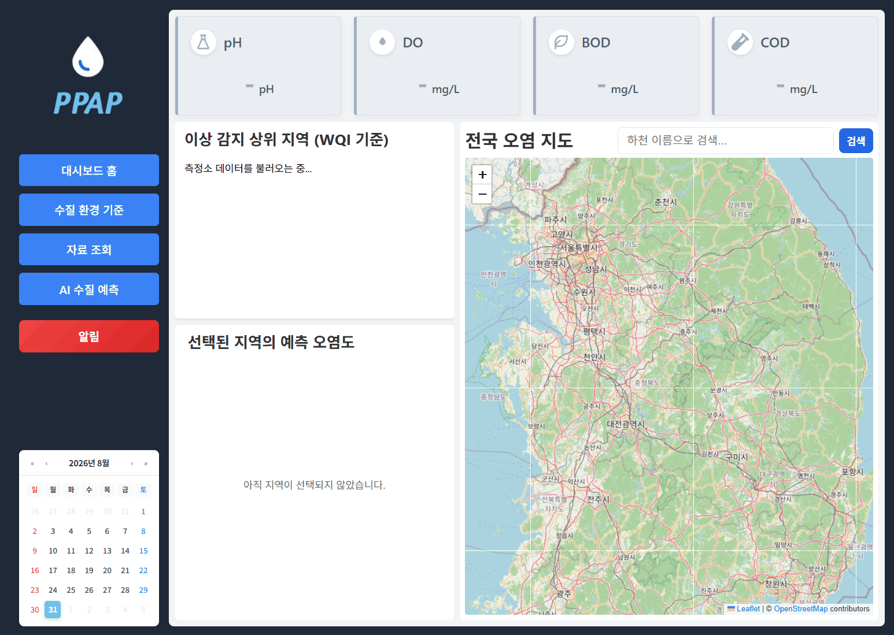

# Water-monitor (PPAP)

U-CUBE 인턴십 프로젝트 - AI 기반 실시간 수질오염 모니터링 및 예측 시스템

하천에 설치된 센서가 MQTT로 전송하는 수질 데이터를 실시간으로 수집·저장하고, 지도 기반 대시보드로 시각화하며, AI 모델을 통해 향후 수질오염지수(WQI)를 예측하고 이상 상황을 알림으로 제공합니다.

## 주요 기능

- **실시간 센서 데이터 수집**: MQTT(Mosquitto)로 수신한 센서 데이터를 백엔드가 구독·저장
- **전국 오염 지도**: Leaflet 기반 지도에서 측정소 위치와 수질 상태를 클러스터로 시각화
- **이상 감지 및 알림**: WQI 기준 위험/경고 등급을 자동 분류해 알림 패널로 표시
- **AI 수질 예측**: Prophet 기반 예측 모델로 수계별 향후 WQI를 예측
- **수질 환경 기준 조회**: 등급별 생활환경기준, WQI 산정 기준표 제공
- **자료 조회 및 다운로드**: 기간별 측정 데이터를 CSV/Excel로 다운로드
- **운영 모니터링**: Prometheus + Grafana로 백엔드 지표 및 시스템 상태 모니터링

## 시스템 구성

```
[센서 디바이스] --MQTT--> [Mosquitto] --구독--> [Backend(Spring Boot)] <--REST--> [Frontend(React)]
                                                        |                              |
                                                        v                              v
                                                    [MySQL]                    [Leaflet 지도 / 차트]
                                                        |
                                                        v
                                              [AI 서버(FastAPI)] --예측 결과--> [Backend]

[Backend] --지표 노출--> [Prometheus] --대시보드--> [Grafana]
```

## 기술 스택

| 영역 | 기술 |
| --- | --- |
| Frontend | React 19, Vite, Chart.js, Leaflet, Axios, STOMP/SockJS |
| Backend | Spring Boot 3.5 (Java 21), Spring Data JPA, WebSocket, Eclipse Paho(MQTT) |
| AI 서버 | FastAPI, Prophet, pandas, scikit-learn |
| 메시지 브로커 | Eclipse Mosquitto (MQTT) |
| 데이터베이스 | MySQL |
| 모니터링 | Prometheus, Grafana |
| 배포 | Docker (서비스별 Dockerfile 제공) |

## 프로젝트 구조

```
Water-monitor/
├── frontend/     # React + Vite 대시보드
├── backend/      # Spring Boot API 서버 (MQTT 구독, DB 연동, 알림)
├── AI/           # FastAPI 기반 WQI 예측 서버
├── mosquitto/    # MQTT 브로커 설정
└── monitoring/   # Prometheus / Grafana 설정
```

## 로컬 실행 방법

### 1. 인프라 준비 (MySQL, Mosquitto)

Docker로 로컬 인프라를 띄웁니다.

```bash
docker run -d --name wm-mysql -p 3307:3306 \
  -e MYSQL_ROOT_PASSWORD=<password> -e MYSQL_DATABASE=water_monitor mysql:8.0

docker run -d --name wm-mosquitto -p 1883:1883 \
  -v "<repo-path>/mosquitto/config/mosquitto.conf:/mosquitto/config/mosquitto.conf" \
  eclipse-mosquitto
```

### 2. 환경 변수 설정

`backend/.env.template`을 복사해 `backend/.env`를 만들고 DB, MQTT, 메일, AI 서버 정보를 채웁니다.

`frontend/`에 `.env`를 만들어 API 주소를 지정합니다.

```
VITE_API_BASE_URL=http://localhost:8085
VITE_API_TIMEOUT=10000
```

### 3. 백엔드 실행

```bash
cd backend
./gradlew bootRun
```

기본 포트: `8085`

### 4. 프론트엔드 실행

```bash
cd frontend
npm install
npm run dev
```

기본 포트: `5173` (충돌 시 `--port` 옵션으로 변경)

### 5. (선택) AI 예측 서버 실행

```bash
cd AI
pip install -r requirements.txt
uvicorn main:app --reload
```

## 데모


